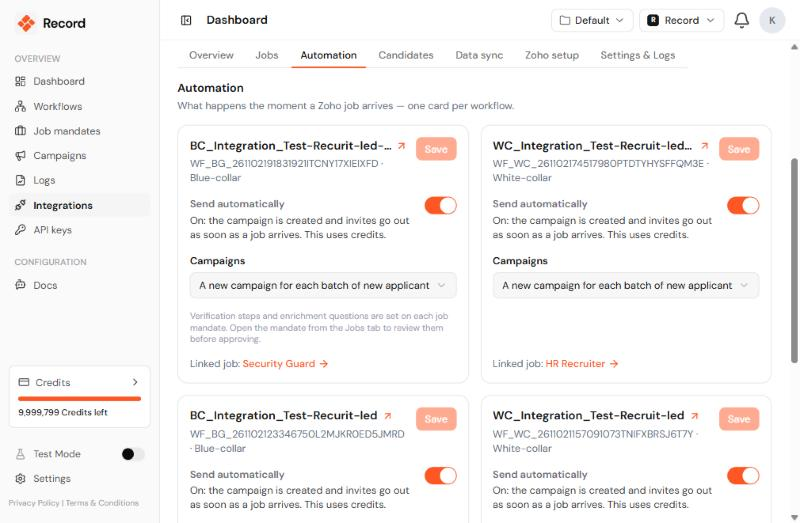
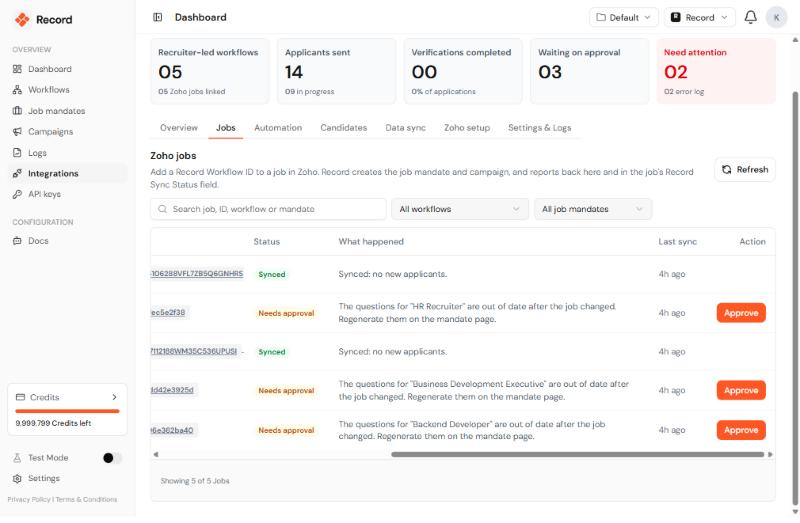

When a recruiter adds a Workflow ID to a job in Zoho, Record creates a job mandate. You decide for each workflow what happens next: wait for someone to approve, or invite applicants straight away.

## What happens when a job arrives

| | Approve first (recommended) | Send automatically |
| --- | --- | --- |
| Job mandate | Created | Created |
| Approval | A person approves it in Record | Not needed |
| Campaign and invites | Created after approval | Created as soon as the job arrives |
| Credits | Used when the invites go out, after approval | Used when the invites go out, as soon as the job arrives |

<Warning>
  Sending automatically starts invites without a review, and the invites use credits. Use it only for workflows whose questions and settings you already trust.
</Warning>

## Set the automation for a workflow

<Steps>
  <Step title="Open the Automation tab">
    On the Zoho Recruit page, open the **Automation** tab. It shows one card for each recruiter-led workflow. Create a recruiter-led workflow first if the tab is empty.

    <Frame caption="The Automation tab. Each workflow has a card with the Send automatically switch, the Campaigns option and a Save button.">
      
    </Frame>
  </Step>

  <Step title="Choose how invites go out">
    On the workflow's card, use the **Send automatically** switch. Leave it **off** to approve each job first, which is the recommended setting. Switch it **on** to create the campaign and send invites as soon as a job arrives.
  </Step>

  <Step title="Choose how campaigns are created">
    Under **Campaigns**, pick one option:

    | Option | What Record does |
    | --- | --- |
    | **A new campaign for each batch of new applicants** | Applicants who are in no campaign yet go into a new campaign and are invited. Earlier campaigns are never added to or changed. |
    | **I create campaigns myself** | Record only creates the job mandate. You create the campaigns. |

    Campaign names look like `ZR-001-002-K7Q`. `ZR-001` is the number in Zoho's own Job Opening ID, the next number counts the batches for that job, and the last three characters are random.
  </Step>

  <Step title="Save">
    Choose **Save** on the card. The button is available once you change something, and Record confirms with the workflow's name.
  </Step>
</Steps>

<Note>
  For blue-collar workflows, the verification steps and enrichment questions are set on each job mandate. Open the mandate from the **Jobs** tab and review them before you approve it.
</Note>

## Approve a job

If **Send automatically** is off, each new job waits for you.

<Steps>
  <Step title="Open the Jobs tab">
    Open the **Jobs** tab. It lists every Zoho job with a Workflow ID, the workflow, the job mandate and what happened at the last sync.

    <Frame caption="The Jobs tab. Scroll the table to the right to see the status, what happened, and an Approve button for each job that needs approval.">
      
    </Frame>
  </Step>

  <Step title="Review the mandate">
    Choose the job mandate ID to open it. Check the questions and settings.
  </Step>

  <Step title="Choose Approve">
    Back on the **Jobs** tab, choose **Approve** on the job. Record creates the campaign and invites the applicants, as you set under **Campaigns**.
  </Step>
</Steps>

### What the job status means

| Status | What it means |
| --- | --- |
| **Synced** | Record processed the job and it is up to date in Record. |
| **Needs approval** | The mandate is ready and waits for you to choose **Approve**. |
| **Blocked** | Record found a problem and created nothing. The reason is in **What happened** and in the job's **Record Sync Status** field in Zoho. |
| **Closed** | The job was closed in Zoho, for example Filled or Cancelled. Record closes the mandate and pauses its campaigns. |
| **No workflow ID** | The job has no Record Workflow ID. Record ignores it until a recruiter adds one. |

The **Jobs** tab hides jobs with no workflow ID. Choose **Show N jobs with no workflow ID** under the table to see them.

## You are set up

Your Zoho account is ready. A recruiter now only has to do two things on a job in Zoho: choose the **Record Collar Type** and enter the **Record Workflow ID**. Record does the rest and reports back in the job's **Record Sync Status** field.
