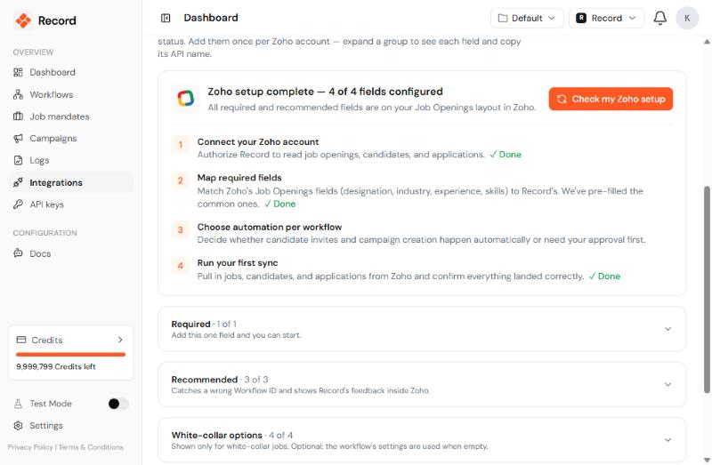
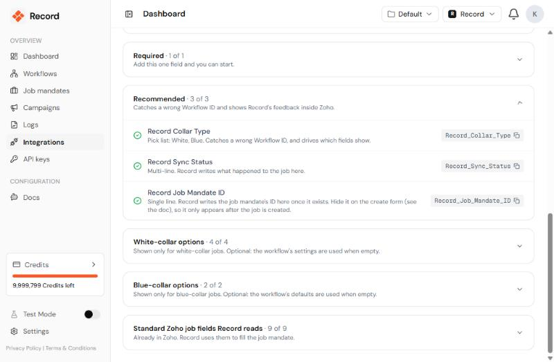

Record can check your Zoho setup for you. The check looks at the jobs from your last sync and shows which Record fields it found.

You need a connection and at least one finished sync. See [Step 3](/zoho-recruit/setup/connect-and-sync).

<Note>
  The check only sees what the last sync stored. After you add or rename a field in Zoho, sync again before you check.
</Note>

## Run the check

<Steps>
  <Step title="Open the Zoho setup tab">
    On the Zoho Recruit page, open the **Zoho setup** tab. Record runs the check once when the tab opens.
  </Step>

  <Step title="Check again when you need to">
    Choose **Check my Zoho setup** to run it again. You can also choose it from the setup card on the **Overview** tab.

    <Frame caption="The Zoho setup tab after a successful check. The card reads Zoho setup complete and lists the four setup steps with their progress.">
      
    </Frame>
  </Step>

  <Step title="Read the status card">
    The card at the top shows how the check went. Under the title it also lists the four setup steps, with **Done** beside each finished one:

    | Title | What it means |
    | --- | --- |
    | **Check your Zoho setup** | The check has not run yet. Choose **Check my Zoho setup**. |
    | **No jobs synced yet** | Run a sync first. A field only shows up once it has been synced from a job. |
    | **Zoho setup incomplete — N of 4 fields configured** | A field is missing. The card names any missing required field. |
    | **Zoho setup complete — 4 of 4 fields configured** | Every required and recommended field is on your Job Openings layout. |
  </Step>
</Steps>

## Read the field groups

Below the status card, the fields are listed in groups. Choose a group to open it. A green tick means Record found the field on your jobs. A grey circle means it did not.

| Group | Fields | Why it matters |
| --- | --- | --- |
| **Required** | Record Workflow ID | Without it Record cannot link a job to a workflow. Add this one field and you can start. |
| **Recommended** | Record Collar Type, Record Sync Status, Record Job Mandate ID | Catches a wrong Workflow ID and shows Record's feedback inside Zoho. |
| **White-collar options** | Record Difficulty, Record Duration, Record Pass Mark, Record Question Mix | Shown only for white-collar jobs. Optional: the workflow's settings are used when empty. |
| **Blue-collar options** | Record Enrichment Questions, Record Verification Steps | Shown only for blue-collar jobs. Optional: the workflow's defaults are used when empty. |
| **Standard Zoho job fields Record reads** | Posting Title, Required Skills, Work Experience, Job Description, Job Opening Status, Salary, Number of Positions, City, Country | Already in Zoho. Record uses them to fill the job mandate. |

The count in the status card covers only the **Required** and **Recommended** groups. The other groups have their own counts.

Each row shows the field's label, a short hint and its **API name**. Choose the API name to copy it, so you can compare it with the name in Zoho.

<Frame caption="The field groups. The Recommended group is open and shows a green tick, a hint and the copyable API name for each field.">
      
    </Frame>

## Fix a missing field

<Steps>
  <Step title="Compare the API name">
    Copy the API name from the row. In Zoho, open **Setup** > **Developer Space** > **APIs** > **API names** and find the field. The two names must match exactly. See [Check the API names](/zoho-recruit/setup/job-fields#check-the-api-names).
  </Step>

  <Step title="Fix it in Zoho">
    Add the field to the **Standard** layout, or correct its API name.
  </Step>

  <Step title="Sync and check again">
    In Record, run **Sync source data** on the **Data sync** tab, then choose **Check my Zoho setup**. Wait 2 minutes between syncs.
  </Step>
</Steps>

<Warning>
  A field with the right label but a different API name shows as missing, and Record ignores its value. This happens most often with labels such as "Record Difficulty (WC)" or a pick list left at "Pick List 1".
</Warning>

## Next step

[Choose how jobs are approved and how campaigns start](/zoho-recruit/setup/automation).
