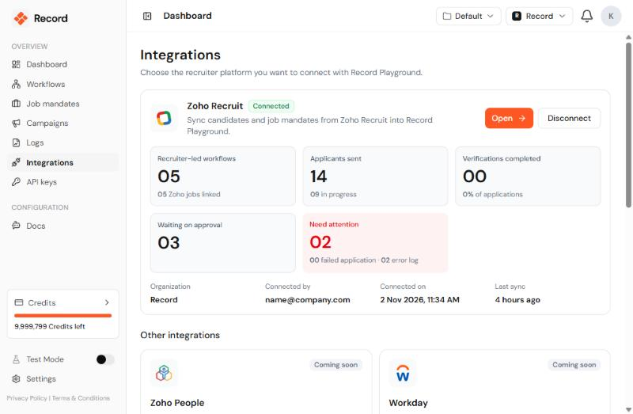
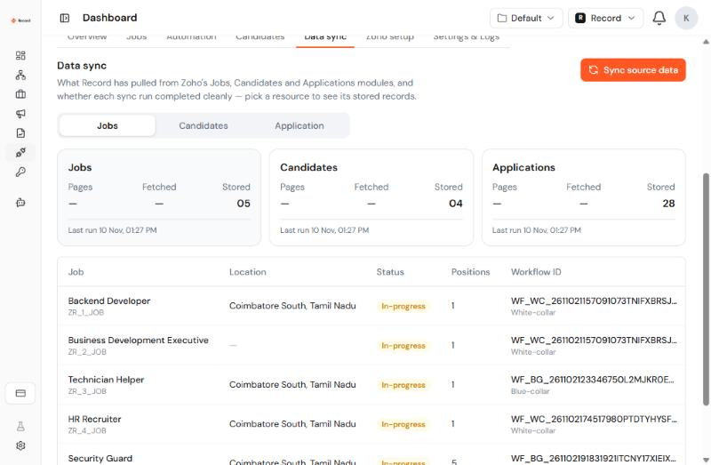

In this step you connect your Zoho Recruit account to Record and run the first sync. Record copies your jobs, candidates and applications so it can check them, create job mandates and invite applicants.

You need the fields from [Step 1](/zoho-recruit/setup/job-fields) and the layout rule from [Step 2](/zoho-recruit/setup/layout-rules) in place first. Record reads the fields from the jobs it syncs, so sync after you add them.

## Connect your Zoho account

<Steps>
  <Step title="Open Integrations">
    In the Record platform, choose **Integrations** in the left sidebar. The page lists the recruiter platforms you can connect. Zoho Recruit is the first card.

    {/* SCREENSHOT 1: the Integrations page with the Zoho Recruit card showing the Connect button.
        Save as docs/images/zoho-recruit/integrations-connect.png */}
  </Step>

  <Step title="Choose Connect">
    Choose **Connect** on the **Zoho Recruit** card. A window opens where you sign in to Zoho and allow Record to read your job openings, candidates and applications.

    {/* SCREENSHOT 2: the Zoho authorization window.
        Save as docs/images/zoho-recruit/zoho-authorize.png */}
  </Step>

  <Step title="Confirm the connection">
    When the window closes, Record shows **Zoho Recruit connected**. The card now has a **connected** badge, tiles that count workflows, applicants and approvals, and your organization, who connected it, when, and the time of the last sync.

    <Frame caption="The Zoho Recruit card after you connect. It shows the connected badge, the activity tiles, and the Open and Disconnect buttons.">
      
    </Frame>
  </Step>

  <Step title="Open the integration">
    Choose **Open** on the card. The Zoho Recruit page opens with these tabs: **Overview**, **Jobs**, **Automation**, **Candidates**, **Data sync**, **Zoho setup** and **Settings & Logs**.
  </Step>
</Steps>

<Note>
  Choose **Disconnect** on the card to remove the connection. Record stops syncing that account until you connect it again.
</Note>

## Run the first sync

<Steps>
  <Step title="Open Data sync">
    On the Zoho Recruit page, open the **Data sync** tab and choose **Sync source data**.
  </Step>

  <Step title="Wait for the run to finish">
    The tab shows one card each for **Jobs**, **Candidates** and **Applications**. Each card counts the **Pages** read, the records **Fetched** from Zoho and the records **Stored** in Record. The page shows **Zoho Recruit sync completed** when all three are done.

    <Frame caption="The Data sync tab after a finished run: one card each for Jobs, Candidates and Applications, then the stored jobs.">
      
    </Frame>
  </Step>

  <Step title="Check the stored jobs">
    Choose **Jobs** to list the stored jobs. Select a job to see all its fields, including the Record fields from Step 1. A job whose Workflow ID is filled in shows it in the **Workflow ID** column.
  </Step>
</Steps>

### If the sync does not start as expected

| Message | What it means |
| --- | --- |
| **Zoho Recruit was synced recently. Showing stored source data.** | A sync finished less than 2 minutes ago, so Record shows the stored data instead of starting a new run. Wait a moment, then sync again. |
| **Zoho Recruit sync is already running** | A run is in progress. Wait for it to finish. |
| **Zoho Recruit API rate limit reached** | Zoho limited the requests. Record resumes the sync by itself after a short wait. |
| **Connect Zoho Recruit before syncing data** | There is no active connection. Go back to **Connect** on the Integrations page. |

## Syncing later

You do not need to press the button each time. Record also syncs on a schedule, so a Workflow ID a recruiter adds in Zoho reaches Record without anyone doing anything. Press **Sync source data** when you want a change to arrive right away, for example after you add a field in Zoho.

## Next step

[Check your setup](/zoho-recruit/setup/check-setup). Record compares the jobs it just synced with the fields it needs and shows what is still missing.
