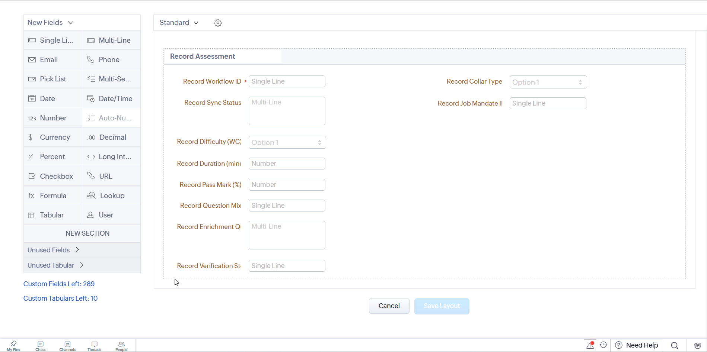
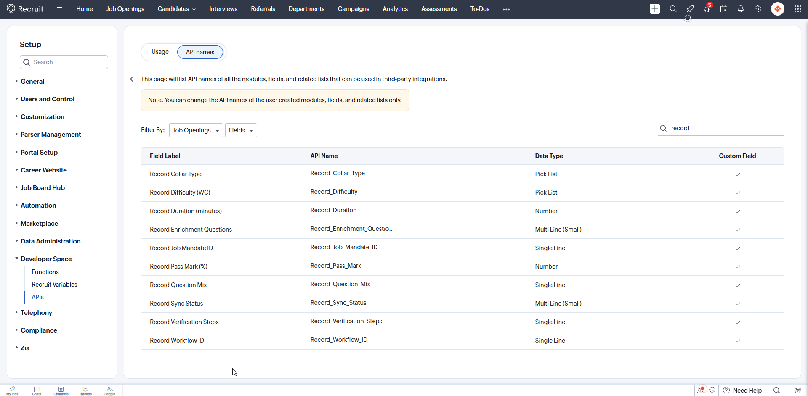

Record reads a job's workflow, collar type and assessment options from custom fields on the **Job Openings** module. In this step you add those fields to the job layout in Zoho Recruit.

<Warning>
  Record finds each field by its **API name**, not its label. A field with the wrong API name is ignored, and the Record **Zoho Setup** check shows it as missing. Follow [Check the API names](#check-the-api-names) after you add the fields.
</Warning>

## The fields

Create all ten fields in one section of the layout. Name the section **Record Assessment**.

### Fields for every job

| Label | API name | Field type | What you enter |
| --- | --- | --- | --- |
| Record Workflow ID | `Record_Workflow_ID` | Single Line | **Required.** The Workflow ID copied from Record, for example `WF_WC_...` or `WF_BG_...`. |
| Record Collar Type | `Record_Collar_Type` | Pick List | Two options: `White` and `Blue`. Record uses it to catch a Workflow ID that belongs to the other collar type. |
| Record Sync Status | `Record_Sync_Status` | Multi-Line | Leave empty. Record writes what happened to the job here. |
| Record Job Mandate ID | `Record_Job_Mandate_ID` | Single Line | Leave empty. Record writes the job mandate's ID here once it exists. |

### White-collar options

| Label | API name | Field type | What you enter |
| --- | --- | --- | --- |
| Record Difficulty (WC) | `Record_Difficulty` | Pick List | Three options: `Easy`, `Medium`, `Hard`. |
| Record Duration (minutes) | `Record_Duration` | Number | The test length in **minutes**. `90` is an hour and a half. |
| Record Pass Mark (%) | `Record_Pass_Mark` | Number | A number from 1 to 100: the percent of the total marks needed to pass, for example `60`. |
| Record Question Mix | `Record_Question_Mix` | Single Line | The question types and marks, for example `MCQ:10x2, Short:3x5`. |

<Note>
  Record only uses the difficulty, duration, pass mark and question mix when the workflow lets recruiters edit marks. Otherwise the workflow's own assessment settings apply and these fields are ignored.
</Note>

### Blue-collar options

| Label | API name | Field type | What you enter |
| --- | --- | --- | --- |
| Record Enrichment Questions | `Record_Enrichment_Questions` | Multi-Line | One question per line, as `question \| yes_no \| yes` or `question \| voice`. |
| Record Verification Steps | `Record_Verification_Steps` | Single Line | The steps to run, for example `skill, enrichment, otherinterest`. |

## Add the fields

<Steps>
  <Step title="Open the Job Openings layout">
    In Zoho Recruit, go to **Setup** > **Customization** > **Modules** > **Job Openings** > **Layouts**, then open the **Standard** layout.

    {/* SCREENSHOT 1: the Layouts page for Job Openings, with the Standard layout visible.
        Save as docs/images/zoho-recruit/open-layouts.png */}
  </Step>

  <Step title="Add a new section">
    Drag **NEW SECTION** from the left panel onto the layout and name it **Record Assessment**.
  </Step>

  <Step title="Add the fields">
    Drag each field type from **New Fields** into the section. For each field, set the **Field Label** first, then choose **Done**.

    <Warning>
      Do not leave the **Field Label** empty. Zoho names a new pick list "Pick List 1" and builds the API name `Pick_List_1` from it. Record cannot read a field with that name.
    </Warning>

    For the two pick lists, add the options from the tables above. Leave the default value as **-None-**.

    {/* SCREENSHOT 2: the Pick List properties dialog for Record Collar Type, with the label filled in and the White and Blue options added.
        Save as docs/images/zoho-recruit/new-pick-list-field.png */}
  </Step>

  <Step title="Make the Workflow ID required">
    Open the properties of **Record Workflow ID** and mark it as **Required**. A job cannot be saved without a Workflow ID.
  </Step>

  <Step title="Save the layout">
    Check that your section matches the screenshot below, then choose **Save Layout**.

    <Frame caption="The Record Assessment section in the Standard layout of Job Openings.">
      
    </Frame>
  </Step>
</Steps>

## Check the API names

Zoho builds a field's API name from its label when you create it. A label such as `Record Difficulty (WC)` produces `Record_Difficulty_WC`, which Record does not recognize.

<Steps>
  <Step title="Open the API names page">
    Go to **Setup** > **Developer Space** > **APIs**, then choose the **API names** tab. Set **Filter By** to **Job Openings** and **Fields**, and type `record` in the search box to list only the Record fields.
  </Step>

  <Step title="Compare each name">
    Check every field against the **API Name** column in the tables above. The name must match exactly, including capital letters and underscores. In the example below, all ten Record fields have the right API names.

    <Frame caption="The API names tab filtered to Job Openings fields. Each Record field shows the API name Record expects.">
      
    </Frame>
  </Step>

  <Step title="Fix any mismatch">
    If a name is wrong, edit it on the same page. Zoho allows this for custom fields such as these. Save the change, then check the **API Name** column again. If a field cannot be edited, delete it and create it again with a plain label, such as `Record Difficulty`. You can then rename the label to add text such as "(WC)". Zoho sets the API name when the field is created, so the label change should not affect it. Confirm that in the **API Name** column.
  </Step>
</Steps>

<Tip>
  Create each field with the plain label first. That gives you the exact API name straight away, and you can add text such as "(minutes)" to the label later.
</Tip>

## Collar type and Workflow ID must match

White-collar Workflow IDs start with `WF_WC_` and blue-collar ones start with `WF_BG_`. Set **Record Collar Type** to the same collar type as the Workflow ID. Record blocks a job when the two disagree, and writes the reason to **Record Sync Status**.

<Note>
  If you add a Zoho validation rule that checks the Workflow ID against the collar type, set **Record Collar Type** and the Workflow ID in the same save. Zoho may check the value saved earlier instead of the one on screen.
</Note>

## Verify

Record checks these fields against the jobs it has synced, so you verify them after you connect Zoho and run a sync. [Step 4](/zoho-recruit/setup/check-setup) shows how. A field with a green tick is ready.

## Next step

[Show the right fields for each collar type](/zoho-recruit/setup/layout-rules). Add a layout rule so white-collar fields appear only for white-collar jobs and blue-collar fields only for blue-collar jobs.
