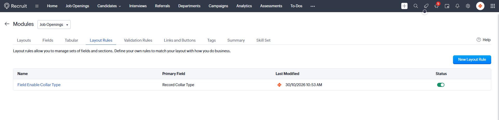
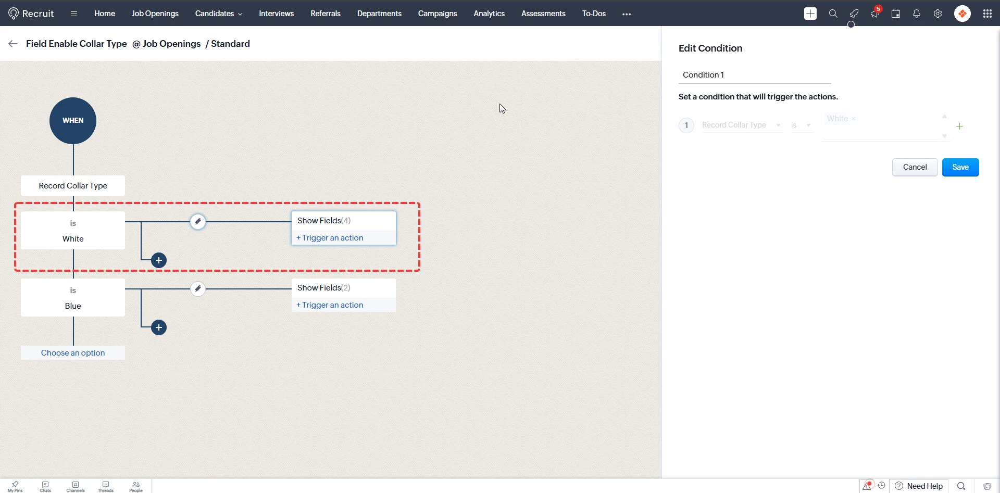
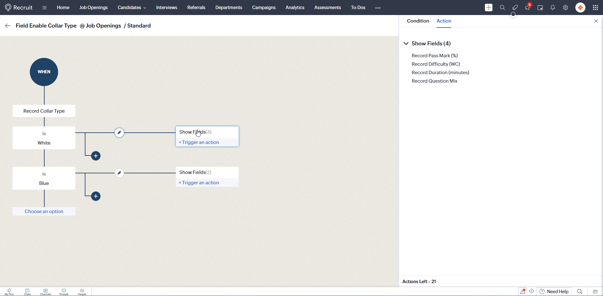
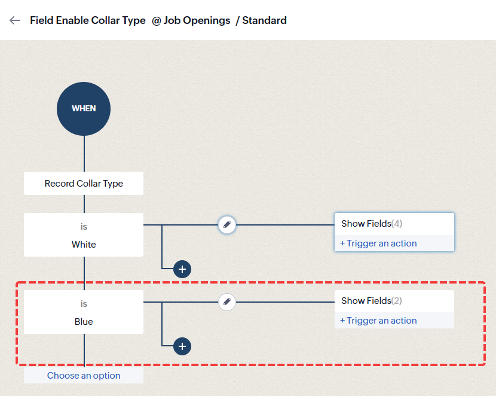
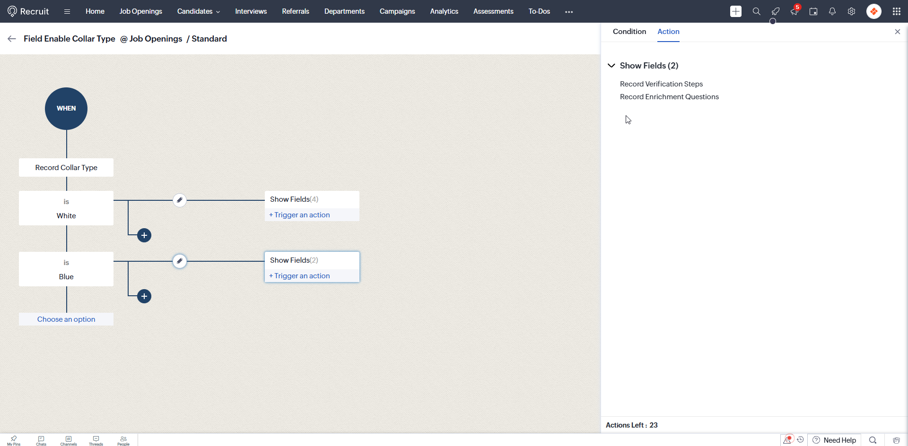
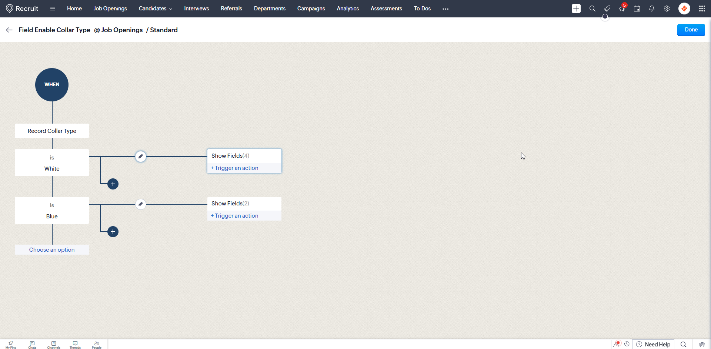

A job is either white-collar or blue-collar, and each type uses different assessment fields. In this step you add one layout rule to Job Openings. The rule watches **Record Collar Type** and shows only the fields that apply, so recruiters never fill in a field Record will ignore.

You need the fields from [Step 1](/zoho-recruit/setup/job-fields) before you start.

## What the rule does

| When Record Collar Type is | Zoho shows these fields |
| --- | --- |
| **White** | 4 fields: Record Difficulty (WC), Record Duration (minutes), Record Pass Mark (%), Record Question Mix |
| **Blue** | 2 fields: Record Enrichment Questions, Record Verification Steps |
| Not chosen | None of the six fields |

These four fields are always visible and are not part of the rule: **Record Workflow ID**, **Record Collar Type**, **Record Sync Status** and **Record Job Mandate ID**.

<Note>
  Leave the default value of **Record Collar Type** as **-None-**, as set in Step 1. The recruiter then has to choose White or Blue before any assessment field appears.
</Note>

## Add the layout rule

<Steps>
  <Step title="Open Layout Rules">
    In Zoho Recruit, go to **Setup** > **Customization** > **Modules** > **Job Openings**, then open the **Layout Rules** tab. Choose **New Layout Rule**.

    <Frame caption="The Layout Rules tab for Job Openings. The rule is named Field Enable Collar Type and its primary field is Record Collar Type.">
      
    </Frame>
  </Step>

  <Step title="Name the rule and pick the primary field">
    Name the rule **Field Enable Collar Type**. Choose the **Standard** layout and set the primary field to **Record Collar Type**. After you save, check that the rule's **Status** switch is on.
  </Step>

  <Step title="Add the white-collar condition">
    In the rule editor, the first box is the field that triggers the rule: **Record Collar Type**. Under it, the first condition box is the white-collar condition. Choose the condition to open the **Edit Condition** panel and set it to:

    **Record Collar Type** · **is** · **White**

    Choose **Save**. The panel's heading, "Set a condition that will trigger the actions", is the condition Zoho checks each time a recruiter changes the collar type.

    <Frame caption="The white-collar condition: Record Collar Type is White.">
      
    </Frame>

    Next, choose **Trigger an action** beside the condition, then **Show Fields**. Select the four white-collar fields:

    - Record Pass Mark (%)
    - Record Difficulty (WC)
    - Record Duration (minutes)
    - Record Question Mix

    The action box then reads **Show Fields(4)**. Choose it at any time to open the **Action** tab and see the fields it shows.

    <Frame caption="The Action tab of the white-collar condition lists the four fields Zoho shows when Record Collar Type is White.">
      
    </Frame>
  </Step>

  <Step title="Add the blue-collar condition">
    Choose the **+** button under the White condition to add a second condition. Set it to:

    **Record Collar Type** · **is** · **Blue**

    <Frame caption="The blue-collar condition, highlighted: Record Collar Type is Blue.">
      
    </Frame>

    Next, choose **Trigger an action** beside the Blue condition, then **Show Fields**. Select the two blue-collar fields:

    - Record Verification Steps
    - Record Enrichment Questions

    The action box then reads **Show Fields(2)**. Choose it to open the **Action** tab and see the fields it shows.

    <Frame caption="The Action tab of the blue-collar condition lists the two fields Zoho shows when Record Collar Type is Blue.">
      
    </Frame>
  </Step>

  <Step title="Check the rule and save">
    The finished rule has one trigger field and two conditions. Leave **Choose an option** at the bottom empty. Choose **Done** to save.

    <Frame caption="The finished rule. White shows four fields and Blue shows two.">
      
    </Frame>
  </Step>
</Steps>

## Test the rule

Create a new job, or open an existing one, and change **Record Collar Type**:

1. Choose **White**. The four white-collar fields appear and the blue-collar fields stay hidden.
2. Choose **Blue**. The two blue-collar fields appear and the white-collar fields are hidden.
3. Choose **-None-**. None of the six fields shows.

{/* SCREENSHOT 3: a Job Openings form with Record Collar Type set to White, showing the four white-collar fields.
    Save as docs/images/zoho-recruit/job-form-white.png */}

{/* SCREENSHOT 4: a Job Openings form with Record Collar Type set to Blue, showing the two blue-collar fields.
    Save as docs/images/zoho-recruit/job-form-blue.png */}

## Next step

[Connect Zoho Recruit and run a sync](/zoho-recruit/setup/connect-and-sync). Record then reads your jobs and the fields you added.
